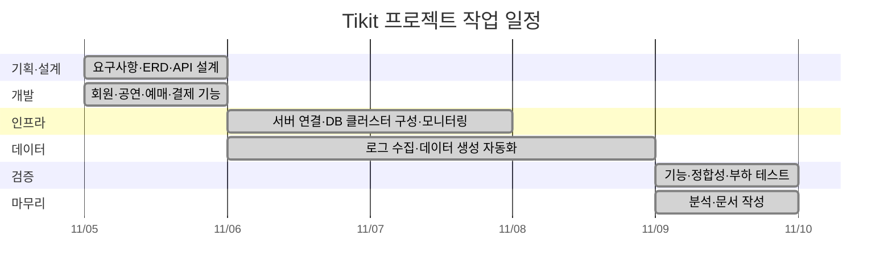

# 🎫 Tikit (티킷)

> 고객 행동 데이터 기반 공연 예매 및 데이터 분석 플랫폼

---

## 01. 👥 팀 소개

**팀명: 티키타카 (TikiTaka)**

| 김한울 | 오정민 | 정상효 |
|:---:|:---:|:---:|
|  |  | |
| [@hannyeee](https://github.com/hannyeee) | [@OZAM0415](https://github.com/OZAM0415) | [@nomorehuman90](https://github.com/nomorehuman90) |
| 예매 및 결제 관리 | 공연 관리 | 회원 관리 |
| 팀장 1 | 팀장 2 | 팀장 3 |

---

## 02. 📌 프로젝트 개요

### 2.1 프로젝트명

**Tikit (티킷)**

### 2.2 프로젝트 소개

콘서트, 뮤지컬, 스포츠, 전시, 클래식, 연극 등 다양한 공연 정보를 제공하고 예매할 수 있는 데이터 기반 공연 예매 플랫폼

### 2.3 프로젝트 배경

- 예매·결제 내역만으로는 사용자의 탐색 과정과 예매 이탈 지점 파악에 한계
- 고객 이용 흐름 분석을 위한 검색·조회·찜 행동과 예매·결제 데이터의 연계 필요
- 요청 집중 상황에서의 데이터 정합성과 처리 성능을 검증 과제로 선정

### 2.4 프로젝트 목표

1. 공연 예매 서비스의 핵심 기능 구현
2. 사용자 행동 및 예매·결제 데이터 수집 환경 구축
3. 데이터 수집·정제·적재를 위한 파이프라인 구축
4. 수집 데이터의 품질 및 정합성 검증
5. 데이터 분석 및 시각화를 통한 정보 제공
6. 부하 테스트를 통한 시스템 및 데이터 처리 성능 검증

---

## 03. 🛠 기술 스택

### 📚 Skills

### ⚙️ Infra

### 📊 Monitoring

### 🤝 Collaboration

---

## 04. 📅 WBS

[요구사항 명세서](https://github.com/encore-ai-campus/mlo-03-p1-team2/wiki/Requirements-Specification)

---

## 05. 🏗 시스템 아키텍처

[시스템 구성 상세](https://github.com/encore-ai-campus/mlo-03-p1-team2/wiki/System-Architecture)

---

## 06. 🗃 ERD

---

## 07. 주요 프로시저

---

## 08. 진행 결과

[기능 소개](https://github.com/encore-ai-campus/mlo-03-p1-team2/wiki/Functional-Specification)

---

## 09. 회고

---

## 10. 문서·실행 안내
