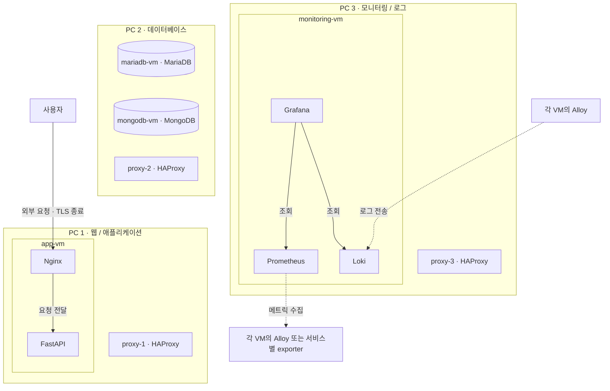

# 🎫 Tikit (티킷)

> 고객 행동 데이터 기반 공연 예매 및 데이터 분석 플랫폼

---

## 01. 👥 팀 소개

**팀명: 티키타카 (TikiTaka)**

| 김한울 | 오정민 | 정상효 |
|:---:|:---:|:---:|
|  |  | |
| [@hannyeee](https://github.com/hannyeee) | [@OZAM0415](https://github.com/OZAM0415) | [@nomorehuman90](https://github.com/nomorehuman90) |
| 예매 및 결제 관리 | 공연 관리 | 회원 관리 |
| 팀장 1 | 팀장 2 | 팀장 3 |

---

## 02. 📌 프로젝트 개요

### 2.1 프로젝트명

**Tikit (티킷)**

### 2.2 프로젝트 소개

Tikit은 콘서트, 뮤지컬, 스포츠, 전시, 클래식, 연극 등 다양한 공연 정보를 제공하고 예매할 수 있는 데이터 기반 공연 예매 플랫폼입니다.

### 2.3 프로젝트 배경

- 공연 서비스에서 발생하는 다양한 사용자 행동 및 거래 데이터의 체계적인 관리 필요
- 고객의 공연 이용 패턴과 공연별 수요를 파악하기 위한 데이터 수집·처리 환경 필요
- 대량의 데이터가 발생하는 환경에서 데이터 처리의 안정성과 정합성을 검증할 필요

### 2.4 프로젝트 목표

1. 공연 예매 서비스의 핵심 기능 구현
2. 사용자 행동 및 예매·결제 데이터 수집 환경 구축
3. 데이터 수집·정제·적재를 위한 파이프라인 구축
4. 수집 데이터의 품질 및 정합성 검증
5. 데이터 분석 및 시각화를 통한 정보 제공
6. 부하 테스트를 통한 시스템 및 데이터 처리 성능 검증

---

## 03. 🛠 기술 스택

### 📚 Skills

### ⚙️ Infra

### 📊 Monitoring

### 🤝 Collaboration

---

## 04. 📅 WBS (Work Breakdown Structure)

프로젝트의 단계별 작업 및 진행 일정을 관리합니다.

| 단계 | 주요 작업 | 담당자 | 일정 | 상태 |
|---|---|---|---|---|
| 1. 기획 | 프로젝트 주제 및 기능 정의 | 전체 | 1일차 | 완료 |
| 2. 설계 | 요구사항 명세서 및 ERD 작성 | 전체 | 1일차 | 완료 |
| 3. 개발 | 회원 기능 구현 | 정상효 | 1일차 | 완료 |
| 3. 개발 | 공연 기능 구현 | 오정민 | 1일차 | 완료 |
| 3. 개발 | 예매·결제 기능 구현 | 김한울 | 1일차 | 완료 |
| 4. 데이터 | 데이터 수집 및 처리 파이프라인 구축 | 전체 | 1일차 | 완료 |
| 5. 인프라 | 서버 네트워크 구성 및 프록시 연결 설정 | 전체 | 2일차 | 완료 |
| 5. 인프라 | 웹·WAS·DB 서버 연동 및 통신 검증 | 전체 | 2일차 | 완료 |
| 5. 인프라 | SSL 인증서 설정 및 HTTPS 적용 | 정상효 | 2일차 | 예정 |
| 6. 모니터링 | 모니터링 서버 구축 및 대시보드 구성 | 오정민 | 2일차 | 완료 |
| 7. 검증 | 기능·데이터·성능 테스트 | 전체 | 3일차 | 예정 |
| 8. 마무리 | 결과 분석 및 발표 자료 작성 | 전체 | 3일차 | 예정 |

※ 기간: 2026-11-05 ~ 2026-11-09 (작업 기간: 3일)

---

## 05. 📋 요구사항 명세서

- [📋 요구사항 이슈](https://github.com/encore-ai-campus/mlo-03-p1-team2/issues)

---

## 06. 🏗 시스템 아키텍처

서비스와 데이터 처리 시스템의 전체 구조를 나타냅니다.

---

## 07. 🗃 ERD (Entity Relationship Diagram)

서비스의 데이터베이스 테이블과 관계를 나타냅니다.

주요 테이블:
- `users`: 회원 기본정보, 로그인 정보 및 MBTI 관리
- `orders`: 공연 주문 내역, 주문 금액 및 주문 상태 관리
- `events`: 사용자 활동 및 예매 관련 이벤트 로그 관리
- `payments`: 결제 금액, 결제 상태 및 결제 처리 이력 관리
- `performances`: 공연 기본정보, 카테고리, 장소, 일정 및 가격 관리
- `reservations`: 공연 예매 정보, 좌석 등급, 수량 및 예매 상태 관리

---

## 08. 📖 API 명세서

| 구분 | Method | Endpoint | 설명 |
|---|---|---|---|
| 회원 | POST | `/users/signup` | 회원가입 |
| 회원 | POST | `/auth/login` | 로그인 |
| 회원 | GET | `/users/me` | 회원정보 조회 |
| 공연 | GET | `/performances` | 공연 목록 조회 |
| 공연 | GET | `/performances/{id}` | 공연 상세 조회 |
| 공연 | POST | `/performances` | 공연 등록 |
| 예매 | POST | `/orders` | 예매 생성 |
| 예매 | GET | `/orders/{id}` | 예매 내역 조회 |
| 결제 | POST | `/orders/{id}/payments` | 결제 요청 |
| 결제 | POST | `/payments/{id}/complete` | 결제 완료 |
| 결제 | POST | `/payments/{id}/cancel` | 결제 취소 |

※ API 경로는 개발 과정에서 변경될 수 있습니다.

---

## 09. 📁 프로젝트 디렉터리 구조

[📂 프로젝트 디렉터리 구조 보기 (Wiki)](https://github.com/encore-ai-campus/mlo-03-p1-team2/wiki/Project-Structure)

---

## 10. 🔄 데이터 파이프라인

### 10.1 데이터 수집

- 회원 데이터
- 공연 정보 데이터
- 공연 조회 및 검색 데이터
- 예매 및 결제 데이터

### 10.2 데이터 처리

- 데이터 추출 및 정제
- 중복 및 결측값 검증
- 데이터 변환 및 집계
- 분석용 데이터 적재

### 10.3 데이터 품질 관리

- 데이터 중복 검증
- 데이터 누락 검증
- 데이터 정합성 검증
- 처리 오류 및 실패 이력 관리

※ 데이터 파이프라인의 세부 기술과 구조는 추후 확정합니다.

---

## 11. 📊 데이터 분석 및 활용

수집된 데이터를 기반으로 분석을 수행하고 결과를 시각화합니다.

- 고객별 공연 이용 패턴 분석
- 공연 카테고리별 예매 현황 분석
- 공연별 수요 및 예매 추이 분석
- 예매·결제 상태별 통계 분석

※ 구체적인 분석 기능과 지표는 추후 확정합니다.

---

## 12. 🧪 테스트 및 성능 검증

### 12.1 기능 테스트

- 회원가입 및 로그인 테스트
- 공연 등록·조회 테스트
- 예매 및 결제 상태 변경 테스트

### 12.2 데이터 검증

- 데이터 누락 및 중복 여부 확인
- 예매·결제 데이터 정합성 검증
- 데이터 처리 결과 검증

### 12.3 부하 테스트

- Locust 기반 동시 사용자 요청 테스트
- 요청 처리량 및 응답시간 측정
- 부하 증가에 따른 시스템 동작 확인

---

## 13. 🔧 트러블슈팅

프로젝트 진행 중 발생한 문제와 해결 과정을 기록합니다.

| 문제 | 원인 | 해결 방법 |
|---|---|---|
| 추후 작성 | 추후 작성 | 추후 작성 |

---

## 14. 🏁 프로젝트 결과 및 회고

### 주요 결과

*프로젝트 완료 후 작성 예정*

### 개선 사항 및 한계점

*프로젝트 완료 후 작성 예정*

### 팀 회고

*프로젝트 완료 후 작성 예정*

---

## 15. 🚀 실행 방법

### 개발 환경

- Python 3.10 이상, Node.js 18 이상
- MySQL 8 또는 MariaDB 10.11 (`tikit` 데이터베이스)

### 설치 및 실행

1. **백엔드**: `backend/.env` 작성 → `tikit` 데이터베이스 생성 → `python -m alembic upgrade head` (예매 테이블 0002 포함) → `python -m app.db.seed` → `python -m uvicorn app.main:app --port 8000`
2. **프론트엔드**
   - 개발: `cd frontend` → `npm install` → `npm run dev` → http://localhost:5173
   - 배포: `npm run build` → `frontend/dist/` 내용을 nginx `html` 폴더에 복사 (`/api/`는 `127.0.0.1:8000`으로 프록시, `try_files ... /index.html` 설정) → http://localhost

자세한 방법과 자주 나는 오류는 [docs/backend.md](docs/backend.md), [docs/frontend.md](docs/frontend.md)를 참고하세요.
