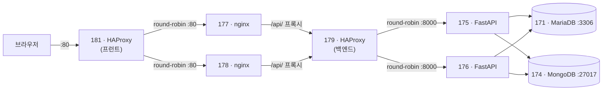

# 프런트엔드 ↔ 백엔드 서버 연결 설정 가이드

| 항목 | 내용 |
|---|---|
| 작성일 | 2026-11-06 |
| 대상 서버 | 192.168.0.181, 177, 178 (프런트) / 192.168.0.179, 175, 176 (백엔드) |
| OS | Ubuntu 24.04.4 LTS (전 서버 공통) |
| 목적 | 프런트 HAProxy → nginx → 백엔드 HAProxy → FastAPI → DB 까지 요청이 흐르도록 연결 |

> 서버 접속 계정과 비밀번호는 이 문서에 적지 않습니다. 팀 내부 채널에서 확인하세요.

---

## 1. 전체 요청 흐름



- nginx(177·178)는 **정적 파일(Vue 빌드 결과)** 을 제공하고, `/api/` 로 시작하는 요청만 백엔드 HAProxy(179)로 넘깁니다.
- 프런트엔드는 API를 상대 경로 `/api/v1` 으로 호출합니다(`frontend/src/api/client.js`). 브라우저 입장에서 같은 출처라 **CORS 설정이 필요 없습니다.**
- 175·176은 nginx가 아닌 **FastAPI(uvicorn) 서버**입니다. 호스트명(`fastapi175`, `fastapi176`)과 179 HAProxy 설정(`:8000`)도 이에 맞춰져 있습니다.

---

## 2. 현재 상태 점검 결과 (2026-11-06)

| 서버 | 역할 | 현재 상태 | 필요한 작업 |
|---|---|---|---|
| 192.168.0.181 | 프런트 HAProxy | `:80` → 177/178 round-robin, `GET /` 헬스체크, stats `:8404` | **없음** |
| 192.168.0.177 | 프런트 nginx | `/var/www/html` 에 빌드 파일 배포됨, `real_ip.conf` 설정됨 | **`/api/` 프록시 추가**, SPA fallback 수정 |
| 192.168.0.178 | 프런트 nginx | 177과 동일 | 177과 동일 |
| 192.168.0.179 | 백엔드 HAProxy | `:80` → 175/176:8000, `GET /health` 체크. 백엔드 미기동으로 **503** 응답 | 필수 없음 (보강 권장) |
| 192.168.0.175 | FastAPI | `/home/test/app` 에 코드만 있음. **venv·pip·.env·실행 프로세스 없음** | **실행 환경 구성 + systemd 등록** |
| 192.168.0.176 | FastAPI | 175와 동일 | 175와 동일 |

공통 확인 사항

- 6대 모두 `ufw` 비활성 → 방화벽 작업 불필요
- 175·176 → MariaDB(171:3306), MongoDB(174:27017), 179:80 **연결 가능**
- 177·178·181 의 호스트명이 모두 `test` 로 동일

---

## 3. 작업 순서

뒤쪽(백엔드)부터 앞쪽(프런트)으로 올라오며 작업하고, 단계마다 동작을 확인합니다.

1. 175·176 — FastAPI 실행
2. 179 — 백엔드 HAProxy 확인/보강
3. 177·178 — nginx `/api/` 프록시 추가
4. 181 — 변경 없음, 확인만
5. 전체 연결 확인

---

## Step 1. FastAPI 서버 (192.168.0.175, 192.168.0.176)

두 서버에 **똑같이** 적용합니다.

### 1-1. 디렉터리 구조 확인

`app` 패키지가 `/home/test/app` 에 있으므로 작업 디렉터리는 `/home/test` 입니다.

```
/home/test/
├── app/               # backend/app 복사본 (main.py, api, core, db, models, schemas)
├── requirements.txt
├── .env               # 새로 생성
└── .venv/             # 새로 생성
```

### 1-2. Python 가상환경과 패키지 설치

```bash
sudo apt update
sudo apt install -y python3-venv python3-pip

cd /home/test
python3 -m venv .venv
.venv/bin/pip install -r requirements.txt
```

### 1-3. 환경 변수 파일 작성

`/home/test/.env` 를 작성합니다. 설정(`app/core/config.py`)은 **실행 디렉터리의 `.env`** 를 읽습니다.

```dotenv
DATABASE_URL=mysql+pymysql://<DB_USER>:<DB_PASSWORD>@192.168.0.171:3306/tikit?charset=utf8mb4
MONGODB_URL=mongodb://<MONGO_USER>:<MONGO_PASSWORD>@192.168.0.174:27017/tikit?authSource=admin
MONGODB_DB=tikit
MONGODB_EVENTS_COLLECTION=events
JWT_SECRET=<긴 랜덤 문자열, 175·176 동일 값>
JWT_EXPIRE_MINUTES=60
```

```bash
chmod 600 /home/test/.env
```

> ⚠️ **`JWT_SECRET` 은 175와 176에서 반드시 같은 값이어야 합니다.**
> 179가 요청을 두 서버에 번갈아 보내므로, 값이 다르면 한 서버에서 발급한 토큰을 다른 서버가 거부해 로그인 직후 401 오류가 납니다.

랜덤 문자열 생성 예시 (한 번 만들어 두 서버에 같이 사용):

```bash
python3 -c "import secrets; print(secrets.token_urlsafe(48))"
```

### 1-4. DB 스키마 확인

서버에는 `alembic/` 디렉터리가 배포되어 있지 않습니다. MariaDB `tikit` 에 테이블이 아직 없다면, **로컬 또는 한 서버에서 한 번만** 마이그레이션을 실행합니다.

```bash
# 로컬 저장소의 backend 디렉터리에서 (.env 의 DATABASE_URL 이 171을 가리키는 상태)
alembic upgrade head
```

### 1-5. 수동 실행으로 확인

```bash
cd /home/test
.venv/bin/uvicorn app.main:app --host 0.0.0.0 --port 8000

# 다른 터미널에서
curl http://localhost:8000/health
# {"status":"ok"}
```

확인 후 `Ctrl+C` 로 종료합니다.

### 1-6. systemd 서비스 등록

`/etc/systemd/system/tikit-api.service`

```ini
[Unit]
Description=TIKIT FastAPI
After=network-online.target
Wants=network-online.target

[Service]
User=test
WorkingDirectory=/home/test
ExecStart=/home/test/.venv/bin/uvicorn app.main:app --host 0.0.0.0 --port 8000 --workers 2 --proxy-headers --forwarded-allow-ips=192.168.0.179
Restart=always
RestartSec=3

[Install]
WantedBy=multi-user.target
```

```bash
sudo systemctl daemon-reload
sudo systemctl enable --now tikit-api
sudo systemctl status tikit-api
```

- `app/` 디렉터리 권한이 `drwx------ test` 이므로 반드시 `User=test` 로 실행합니다.
- `--proxy-headers --forwarded-allow-ips=192.168.0.179` : 179가 넘겨주는 `X-Forwarded-For` 를 신뢰해 실제 사용자 IP를 인식합니다.
- 로그 확인: `journalctl -u tikit-api -f`

---

## Step 2. 백엔드 HAProxy (192.168.0.179)

Step 1이 끝나면 **현재 설정 그대로도 동작**합니다. 아래는 권장 보강안입니다.

`/etc/haproxy/haproxy.cfg` 의 `frontend` / `backend` 부분:

```haproxy
frontend webserver
    bind *:80
    mode http
    option forwardfor                       # 실제 사용자 IP를 X-Forwarded-For 로 전달
    default_backend fastapi-server

backend fastapi-server
    mode http
    balance roundrobin
    option httpchk GET /health
    http-check expect status 200            # 200이 아니면 제외
    server fastapi1 192.168.0.175:8000 check inter 3s fall 3 rise 2
    server fastapi2 192.168.0.176:8000 check inter 3s fall 3 rise 2
```

통계 화면(`:9000`)에 인증이 없으므로 추가를 권장합니다.

```haproxy
listen stats
    bind *:9000
    mode http
    stats enable
    stats uri /stats
    stats auth <STATS_USER>:<STATS_PASSWORD>
```

적용 및 확인:

```bash
sudo haproxy -c -f /etc/haproxy/haproxy.cfg   # 문법 검사
sudo systemctl reload haproxy
curl http://192.168.0.179/health              # {"status":"ok"}
```

---

## Step 3. 프런트 nginx (192.168.0.177, 192.168.0.178)

두 서버에 **똑같이** 적용합니다.

### 3-1. 사이트 설정 수정

`/etc/nginx/sites-available/default` 의 `server { }` 블록을 아래와 같이 수정합니다.

```nginx
server {
    listen 80 default_server;
    listen [::]:80 default_server;
    server_name _;
    root /var/www/html;
    index index.html;
    charset utf-8;
    server_tokens off;

    # 백엔드 API 프록시 → 백엔드 HAProxy(179)
    location /api/ {
        proxy_pass http://192.168.0.179;      # 끝에 '/' 없음 → /api/v1/... 경로 그대로 전달
        proxy_http_version 1.1;
        proxy_set_header Host $host;
        proxy_set_header X-Real-IP $remote_addr;
        proxy_set_header X-Forwarded-For $proxy_add_x_forwarded_for;
        proxy_set_header X-Forwarded-Proto $scheme;
        proxy_read_timeout 30s;
        client_max_body_size 1m;
    }

    # 해시가 붙은 빌드 파일은 길게 캐시
    location /assets/ {
        add_header Cache-Control "public, max-age=31536000, immutable" always;
        try_files $uri =404;
    }

    # Vue Router(history 모드): /login 등 새로고침 시 index.html 반환
    location / {
        add_header Cache-Control "no-cache" always;
        try_files $uri $uri/ /index.html;
    }
}
```

변경 포인트

| 항목 | 기존 | 변경 | 이유 |
|---|---|---|---|
| `/api/` | 없음 | 179로 프록시 | API 요청이 백엔드로 전달되도록 |
| `location /` | `try_files ... =404` | `try_files ... /index.html` | `/login` 같은 주소에서 새로고침 시 404 방지 |

> 보안 헤더(CSP 등)까지 포함한 전체 설정은 저장소의 `frontend/nginx/templates/default.conf.template` 에 있습니다. `${BACKEND_UPSTREAM}` 을 `192.168.0.179` 로 바꿔 사용할 수 있습니다.

`/etc/nginx/conf.d/real_ip.conf` 는 이미 있으므로 그대로 둡니다.

```nginx
set_real_ip_from 192.168.0.181;
real_ip_header X-Forwarded-For;
```

### 3-2. 적용

```bash
sudo nginx -t
sudo systemctl reload nginx
```

### 3-3. 프런트 빌드 배포 (코드 변경 시)

```bash
# 로컬
cd frontend
npm run build          # frontend/dist 생성

# dist 내용을 177·178 의 /var/www/html 로 복사
scp -r dist/* test@192.168.0.177:/tmp/dist/
# 서버에서
sudo rsync -a --delete /tmp/dist/ /var/www/html/
```

---

## Step 4. 프런트 HAProxy (192.168.0.181)

변경할 내용이 없습니다. 현재 설정:

```haproxy
frontend http_in
    bind *:80
    option forwardfor
    default_backend nginx_servers

backend nginx_servers
    balance roundrobin
    option httpchk
    http-check send meth GET uri /
    http-check expect status 200
    server nginx1 192.168.0.177:80 check inter 3s fall 3 rise 2
    server nginx2 192.168.0.178:80 check inter 3s fall 3 rise 2
```

---

## Step 5. 전체 연결 확인

안쪽부터 한 단계씩 확인합니다.

```bash
# 1) FastAPI 단독
curl -s http://192.168.0.175:8000/health
curl -s http://192.168.0.176:8000/health

# 2) 백엔드 HAProxy
curl -s http://192.168.0.179/health

# 3) nginx → 179 (실제 API 경로 사용)
curl -s http://192.168.0.177/api/v1/<엔드포인트>
curl -s http://192.168.0.178/api/v1/<엔드포인트>

# 4) 전체 경로 (사용자 진입점)
curl -s http://192.168.0.181/api/v1/<엔드포인트>
```

브라우저 확인

- 서비스: `http://192.168.0.181/`
- 프런트 HAProxy 상태: `http://192.168.0.181:8404/stats` → nginx1, nginx2 **UP**
- 백엔드 HAProxy 상태: `http://192.168.0.179:9000/stats` → fastapi1, fastapi2 **UP**

---

## 6. 문제 해결

| 증상 | 확인할 곳 | 원인 / 조치 |
|---|---|---|
| 179에서 `503` | `systemctl status tikit-api` (175·176) | FastAPI 미기동 또는 `/health` 실패 |
| 화면은 나오는데 API가 `404` | 177·178 nginx 설정 | `/api/` location 누락 |
| `/login` 등에서 새로고침 시 `404` | 177·178 `location /` | `try_files ... /index.html` 로 수정 |
| 로그인 직후 간헐적 `401` | 175·176 `.env` | `JWT_SECRET` 값 불일치 |
| `502 Bad Gateway` (nginx) | `/var/log/nginx/error.log` | 179 접속 불가 또는 HAProxy 중지 |
| FastAPI 시작 실패 | `journalctl -u tikit-api` | `.env` 위치/DB 접속 정보/패키지 설치 확인 |
| DB 테이블 없음 오류 | MariaDB 171 | `alembic upgrade head` 실행 |

---

## 7. 참고 사항

- **로컬 개발 환경**: `frontend/vite.config.js` 의 `/api` 프록시 대상은 기본값을 `http://127.0.0.1:8000` 으로 두고, 서버 연결이 필요할 때 환경 변수로 지정하는 것을 권장합니다.
  ```bash
  BACKEND_URL=http://192.168.0.179 npm run dev
  ```
- **호스트명**: 177·178·181 의 호스트명이 모두 `test` 입니다. Alloy/Prometheus 에서 서버를 구분하려면 변경을 권장합니다.
  ```bash
  sudo hostnamectl set-hostname nginx177   # 예시
  ```
- **CORS**: 브라우저는 항상 같은 출처(181)로 요청하므로 `CORS_ORIGINS` 변경은 필요 없습니다.

---

## 8. SSL(HTTPS) 적용

### 8-1. 적용 범위와 순서

| 단계 | 암호화 구간 | 수정 서버 |
|---|---|---|
| **1단계** | 브라우저 ⇄ **181** | 181, 177·178 (헤더 1줄) |
| **2단계-A** | 181 → 177·178 | 181, 177·178 |
| **2단계-B** | 177·178 → 179 | 177·178, 179 |
| **2단계-C** | 179 → 175·176 | 179, 175·176 |


- **한 단계씩 적용하고 확인한 뒤 다음 단계로 넘어갑니다.** 문제가 생기면 해당 단계만 되돌립니다.
- 1단계만 적용해도 사용자 구간은 암호화됩니다. 2단계는 내부망 구간까지 암호화할 때 진행합니다.
- 수정 전에는 항상 설정 파일을 백업합니다.
  ```bash
  sudo cp /etc/haproxy/haproxy.cfg /etc/haproxy/haproxy.cfg.bak.$(date +%Y%m%d%H%M)
  sudo cp /etc/nginx/sites-available/default /etc/nginx/sites-available/default.bak.$(date +%Y%m%d%H%M)
  ```

### 8-2. 인증서 준비 요건

서버마다 인증서와 키를 하나씩 준비합니다. 서버끼리 인증서를 검증하려면(2단계) 서버 인증서를 발급한 **CA 인증서**도 필요합니다.

| 서버 | 파일 | SAN (필수) | 필요 단계 |
|---|---|---|---|
| 181 | `181.crt`, `181.key` | `IP:192.168.0.181` (+ 사용할 도메인) | 1단계 |
| 177 | `177.crt`, `177.key` | `IP:192.168.0.177` | 2-A |
| 178 | `178.crt`, `178.key` | `IP:192.168.0.178` | 2-A |
| 179 | `179.crt`, `179.key` | `IP:192.168.0.179` | 2-B |
| 175 | `175.crt`, `175.key` | `IP:192.168.0.175` | 2-C |
| 176 | `176.crt`, `176.key` | `IP:192.168.0.176` | 2-C |
| 공통 | `tikit-ca.crt` (CA 인증서) | — | 2단계 전체 |

인증서 요건

- IP로 접속하므로 **SAN(subjectAltName)에 IP가 반드시 들어가야** 합니다. CN만 있으면 브라우저와 HAProxy/nginx 검증이 실패합니다.
- 중간 인증서가 있다면 `*.crt` 에 **서버 인증서 → 중간 인증서** 순서로 이어 붙입니다.
- 서버 인증서 유효기간은 825일 이하로 발급합니다 (macOS/iOS 제한).
- 키 파일은 암호(passphrase)가 없어야 합니다. 있으면 서비스가 시작될 때 멈춥니다.
- **CA 키와 서버 키는 git 에 올리지 않습니다.**

사설 CA 또는 자체 서명 인증서를 쓸 경우, 접속하는 PC에 CA 인증서를 신뢰할 수 있는 루트로 등록해야 브라우저 경고가 사라집니다.

| 환경 | 등록 방법 |
|---|---|
| Windows (Chrome·Edge) | `certmgr.msc` → 신뢰할 수 있는 루트 인증 기관 → 인증서 → 가져오기 |
| macOS | 키체인 접근 → 시스템 → 가져오기 후 "항상 신뢰" |
| Firefox | 설정 → 인증서 보기 → 인증 기관 → 가져오기 |
| Ubuntu 서버 (curl 등) | `sudo cp tikit-ca.crt /usr/local/share/ca-certificates/ && sudo update-ca-certificates` |

### 8-3. 인증서 확인 (적용 전)

로컬 PC 또는 서버에서 각 인증서를 확인합니다.

```bash
# SAN 에 IP 가 들어 있는지
openssl x509 -in 181.crt -noout -ext subjectAltName
# 유효기간
openssl x509 -in 181.crt -noout -dates
# 인증서와 키가 짝이 맞는지 (두 값이 같아야 함)
openssl x509 -in 181.crt -noout -pubkey | openssl sha256
openssl pkey -in 181.key -pubout | openssl sha256
# CA 로 검증되는지 (2단계)
openssl verify -CAfile tikit-ca.crt 181.crt
```

### 8-4. 인증서 파일 배치

로컬 PC에서 각 서버로 복사한 뒤, 서버에서 정해진 위치로 옮깁니다.

```bash
# 로컬 PC → 서버 (예: 181)
scp 181.crt 181.key tikit-ca.crt test@192.168.0.181:/tmp/
```

| 서버 | 위치 | 소유자 / 권한 |
|---|---|---|
| 181, 179 (HAProxy) | `/etc/haproxy/certs/tikit.pem` (crt+key 합본), `/etc/haproxy/certs/tikit-ca.crt` | `root:root`, pem `600` |
| 177, 178 (nginx) | `/etc/nginx/ssl/<IP끝자리>.crt`, `.key`, `tikit-ca.crt` | `root:root`, key `600` |
| 175, 176 (FastAPI) | `/home/test/ssl/<IP끝자리>.crt`, `.key`, `tikit-ca.crt` | `test:test`, key `600` |

**HAProxy (181, 179)** — 인증서와 키를 하나의 PEM으로 합칩니다.

```bash
sudo mkdir -p /etc/haproxy/certs
cat /tmp/181.crt /tmp/181.key | sudo tee /etc/haproxy/certs/tikit.pem > /dev/null   # 179 는 179.crt / 179.key
sudo cp /tmp/tikit-ca.crt /etc/haproxy/certs/
sudo chmod 600 /etc/haproxy/certs/tikit.pem
sudo chmod 644 /etc/haproxy/certs/tikit-ca.crt
rm /tmp/181.crt /tmp/181.key
```

**nginx (177, 178)**

```bash
sudo mkdir -p /etc/nginx/ssl
sudo mv /tmp/177.crt /tmp/177.key /tmp/tikit-ca.crt /etc/nginx/ssl/   # 178 은 178.*
sudo chmod 600 /etc/nginx/ssl/177.key
sudo chmod 644 /etc/nginx/ssl/177.crt /etc/nginx/ssl/tikit-ca.crt
```

**FastAPI (175, 176)**

```bash
mkdir -p /home/test/ssl
mv /tmp/175.crt /tmp/175.key /tmp/tikit-ca.crt /home/test/ssl/   # 176 은 176.*
chmod 700 /home/test/ssl
chmod 600 /home/test/ssl/175.key
```

---

### 8-5. [1단계] 브라우저 ⇄ 181 HTTPS

#### 181 HAProxy

`/etc/haproxy/haproxy.cfg` 의 `frontend http_in` 을 수정합니다.

```haproxy
frontend http_in
    bind *:80
    bind *:443 ssl crt /etc/haproxy/certs/tikit.pem alpn h2,http/1.1
    http-request redirect scheme https code 301 unless { ssl_fc }      # HTTP → HTTPS
    http-request set-header X-Forwarded-Proto https if { ssl_fc }
    option forwardfor
    default_backend nginx_servers
```

- `global` 의 `ssl-default-bind-*` (TLS 1.2 이상) 설정은 이미 있으므로 그대로 둡니다.
- HSTS(`Strict-Transport-Security`)는 **모든 단계가 안정된 뒤** 추가합니다. 먼저 넣으면 문제가 생겼을 때 브라우저가 HTTP 로 돌아가지 못합니다.
  ```haproxy
  http-response set-header Strict-Transport-Security "max-age=31536000"
  ```

stats 화면(:8404)도 HTTPS로 바꾸려면:

```haproxy
listen stats
    bind *:8404 ssl crt /etc/haproxy/certs/tikit.pem
    ...
```

적용:

```bash
sudo haproxy -c -f /etc/haproxy/haproxy.cfg
sudo systemctl reload haproxy
```

#### 177·178 nginx — 헤더 1줄 수정

181에서 TLS를 처리하면 nginx의 `$scheme` 은 `http` 가 됩니다. 앞단에서 받은 값을 그대로 넘기도록 바꿉니다.

`/etc/nginx/sites-available/default` 의 `location /api/`:

```nginx
proxy_set_header X-Forwarded-Proto $http_x_forwarded_proto;   # 기존: $scheme
```

```bash
sudo nginx -t && sudo systemctl reload nginx
```

#### 1단계 확인

```bash
curl -I http://192.168.0.181/                                   # 301, Location: https://...
curl --cacert tikit-ca.crt -s https://192.168.0.181/ -o /dev/null -w "%{http_code}\n"   # 200
curl --cacert tikit-ca.crt -s https://192.168.0.181/api/v1/<엔드포인트>
openssl s_client -connect 192.168.0.181:443 -CAfile tikit-ca.crt </dev/null 2>/dev/null | grep "Verify return code"
# Verify return code: 0 (ok)
```

브라우저에서 `https://192.168.0.181/` 접속 → 자물쇠 표시, 로그인·예매 등 API 동작 확인.

#### 1단계 되돌리기

`bind *:443 ...`, `redirect`, `set-header` 3줄을 주석 처리하고 `systemctl reload haproxy`.

---

### 8-6. [2단계-A] 181 → 177·178 HTTPS

#### 177·178 nginx

`/etc/nginx/sites-available/default` 의 `server` 블록에 443 을 추가합니다. (177 기준, 178 은 파일명만 `178.*`)

```nginx
server {
    listen 80 default_server;
    listen [::]:80 default_server;
    listen 443 ssl default_server;
    listen [::]:443 ssl default_server;
    http2 on;

    ssl_certificate     /etc/nginx/ssl/177.crt;
    ssl_certificate_key /etc/nginx/ssl/177.key;
    ssl_protocols TLSv1.2 TLSv1.3;
    ssl_session_cache shared:SSL:10m;
    ssl_session_timeout 1h;

    ...기존 설정(root, location /api/, /assets/, /) 그대로...
}
```

`/etc/nginx/nginx.conf` 의 오래된 프로토콜 설정도 정리합니다.

```nginx
ssl_protocols TLSv1.2 TLSv1.3;   # 기존: TLSv1 TLSv1.1 TLSv1.2 TLSv1.3
```

```bash
sudo nginx -t && sudo systemctl reload nginx
curl --cacert /etc/nginx/ssl/tikit-ca.crt -s https://192.168.0.177/ -o /dev/null -w "%{http_code}\n"   # 200
```

> 이 시점에는 80 포트도 그대로 열려 있어 181이 아직 HTTP 로 접속합니다. 181 을 바꾼 뒤 80 을 정리합니다.

#### 181 HAProxy

`backend nginx_servers` 의 `server` 줄을 443 + 인증서 검증으로 바꿉니다.

```haproxy
backend nginx_servers
    balance roundrobin
    option httpchk
    http-check send meth GET uri /
    http-check expect status 200
    server nginx1 192.168.0.177:443 ssl verify required ca-file /etc/haproxy/certs/tikit-ca.crt check check-ssl inter 3s fall 3 rise 2
    server nginx2 192.168.0.178:443 ssl verify required ca-file /etc/haproxy/certs/tikit-ca.crt check check-ssl inter 3s fall 3 rise 2
```

```bash
sudo haproxy -c -f /etc/haproxy/haproxy.cfg && sudo systemctl reload haproxy
```

`https://192.168.0.181:8404/stats` 에서 nginx1, nginx2 가 **UP** 인지 확인합니다.

#### 177·178 의 80 포트 정리 (선택)

181 외에는 접근할 필요가 없으므로 `listen 80` 두 줄을 제거하거나, 별도 server 블록으로 HTTPS 리다이렉트만 남깁니다.

```nginx
server {
    listen 80 default_server;
    listen [::]:80 default_server;
    return 301 https://$host$request_uri;
}
```

---

### 8-7. [2단계-B] 177·178 → 179 HTTPS

#### 179 HAProxy

`frontend webserver` 에 443 을 추가합니다. (80 은 전환이 끝날 때까지 유지)

```haproxy
frontend webserver
    bind *:80
    bind *:443 ssl crt /etc/haproxy/certs/tikit.pem
    mode http
    option forwardfor
    default_backend fastapi-server
```

```bash
sudo haproxy -c -f /etc/haproxy/haproxy.cfg && sudo systemctl reload haproxy
curl --cacert /etc/haproxy/certs/tikit-ca.crt -s https://192.168.0.179/health   # {"status":"ok"}
```

#### 177·178 nginx

`location /api/` 를 HTTPS + 인증서 검증으로 바꿉니다.

```nginx
location /api/ {
    proxy_pass https://192.168.0.179;
    proxy_ssl_verify on;
    proxy_ssl_trusted_certificate /etc/nginx/ssl/tikit-ca.crt;
    proxy_ssl_verify_depth 2;
    proxy_ssl_name 192.168.0.179;
    proxy_ssl_session_reuse on;

    proxy_http_version 1.1;
    proxy_set_header Host $host;
    proxy_set_header X-Real-IP $remote_addr;
    proxy_set_header X-Forwarded-For $proxy_add_x_forwarded_for;
    proxy_set_header X-Forwarded-Proto $http_x_forwarded_proto;
    proxy_read_timeout 30s;
    client_max_body_size 1m;
}
```

```bash
sudo nginx -t && sudo systemctl reload nginx
curl --cacert /etc/nginx/ssl/tikit-ca.crt -s https://192.168.0.177/api/v1/<엔드포인트>
```

두 서버 모두 정상이면 179 의 `bind *:80` 을 제거합니다.

---

### 8-8. [2단계-C] 179 → 175·176 HTTPS

#### 175·176 FastAPI

`/etc/systemd/system/tikit-api.service` 의 `ExecStart` 를 8443 + TLS 로 바꿉니다. (175 기준, 176 은 `176.*`)

```ini
ExecStart=/home/test/.venv/bin/uvicorn app.main:app --host 0.0.0.0 --port 8443 --workers 2 \
  --ssl-certfile /home/test/ssl/175.crt \
  --ssl-keyfile /home/test/ssl/175.key \
  --proxy-headers --forwarded-allow-ips=192.168.0.179
```

```bash
sudo systemctl daemon-reload
sudo systemctl restart tikit-api
curl --cacert /home/test/ssl/tikit-ca.crt -s https://192.168.0.175:8443/health   # {"status":"ok"}
```

> 서비스를 재시작하는 순간 8000 포트가 닫히므로 179 의 해당 서버가 DOWN 이 됩니다.
> **175 를 먼저 바꾸고 179 설정까지 마친 뒤 176 을 바꾸면** 서비스가 끊기지 않습니다.

#### 179 HAProxy

```haproxy
backend fastapi-server
    mode http
    balance roundrobin
    option httpchk GET /health
    http-check expect status 200
    server fastapi1 192.168.0.175:8443 ssl verify required ca-file /etc/haproxy/certs/tikit-ca.crt check check-ssl inter 3s fall 3 rise 2
    server fastapi2 192.168.0.176:8443 ssl verify required ca-file /etc/haproxy/certs/tikit-ca.crt check check-ssl inter 3s fall 3 rise 2
```

```bash
sudo haproxy -c -f /etc/haproxy/haproxy.cfg && sudo systemctl reload haproxy
```

`http://192.168.0.179:9000/stats` 에서 fastapi1, fastapi2 가 **UP** 인지 확인합니다.

> uvicorn 이 TLS 를 직접 처리하면 CPU 사용량이 다소 늘어납니다. 부하 테스트 결과에 영향이 크면 이 구간(2-C)만 HTTP 로 유지하는 것도 선택지입니다.

---

### 8-9. 최종 확인

```bash
# 전체 경로 (사용자 진입점)
curl --cacert tikit-ca.crt -s https://192.168.0.181/api/v1/<엔드포인트>

# 구간별 인증서 검증 결과 — 모두 "0 (ok)"
for t in 192.168.0.181:443 192.168.0.177:443 192.168.0.178:443 192.168.0.179:443 192.168.0.175:8443 192.168.0.176:8443; do
  printf "%s  " $t
  openssl s_client -connect $t -CAfile tikit-ca.crt </dev/null 2>/dev/null | grep "Verify return code"
done

# 만료일 확인
echo | openssl s_client -connect 192.168.0.181:443 2>/dev/null | openssl x509 -noout -enddate
```

모든 단계가 안정되면 181 에 HSTS 헤더를 추가합니다 (8-5 참고).

### 8-10. SSL 문제 해결

| 증상 | 원인 / 조치 |
|---|---|
| 브라우저 `NET::ERR_CERT_AUTHORITY_INVALID` | 접속 PC에 CA 인증서 미등록 (8-2 참고) |
| 브라우저 `NET::ERR_CERT_COMMON_NAME_INVALID` | 인증서 SAN 에 접속한 IP/도메인이 없음 |
| HAProxy 시작 실패 `unable to load SSL private key` | `tikit.pem` 에 키 누락, 또는 키에 암호가 걸려 있음 |
| HAProxy stats 에서 서버 `L6RSP` / `L6TOUT` DOWN | 대상 포트가 HTTPS 가 아님, 또는 `check-ssl` 누락 |
| HAProxy stats 에서 `SSL handshake failure` | 대상 서버 인증서가 CA 로 검증되지 않음, SAN IP 불일치 |
| nginx `502` + error.log 에 `upstream SSL certificate verify error` | `proxy_ssl_trusted_certificate` 경로 또는 `proxy_ssl_name` 확인 |
| uvicorn 시작 실패 `PermissionError` | 키 파일 소유자가 `test` 가 아님 |
| 로그인 후 리다이렉트 주소가 `http://` | `X-Forwarded-Proto` 전달 누락 (8-5 nginx 수정 확인) |

### 8-11. 인증서 관리

- 인증서 만료일을 이 문서 또는 팀 일정에 기록합니다.
- 인증서를 교체할 때는 같은 경로에 파일을 덮어쓰고 `reload` (HAProxy·nginx) / `restart` (uvicorn) 합니다.
- 키 파일이 저장소에 들어가지 않도록 `*.key`, `*.pem`, `*.crt` 를 `.gitignore` 에 추가합니다.
- 로컬 개발에서 HTTPS 백엔드에 연결할 경우, Vite 프록시는 사설 CA 를 신뢰하지 않으므로 `NODE_EXTRA_CA_CERTS=tikit-ca.crt` 를 지정하거나 프록시 설정에 `secure: false` 를 추가합니다.
