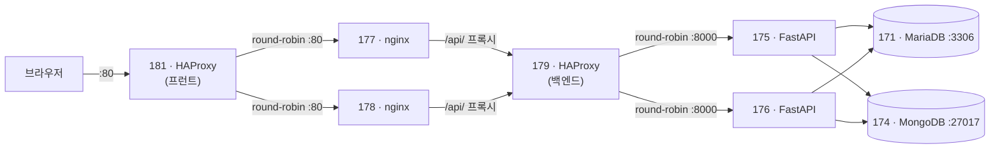

# 프런트엔드 ↔ 백엔드 서버 연결 설정 가이드

| 항목 | 내용 |
|---|---|
| 작성일 | 2026-11-06 |
| 대상 서버 | 192.168.0.181, 177, 178 (프런트) / 192.168.0.179, 175, 176 (백엔드) |
| OS | Ubuntu 24.04.4 LTS (전 서버 공통) |
| 목적 | 프런트 HAProxy → nginx → 백엔드 HAProxy → FastAPI → DB 까지 요청이 흐르도록 연결 |

> 서버 접속 계정과 비밀번호는 이 문서에 적지 않습니다. 팀 내부 채널에서 확인하세요.

---

## 1. 전체 요청 흐름



- nginx(177·178)는 **정적 파일(Vue 빌드 결과)** 을 제공하고, `/api/` 로 시작하는 요청만 백엔드 HAProxy(179)로 넘깁니다.
- 프런트엔드는 API를 상대 경로 `/api/v1` 으로 호출합니다(`frontend/src/api/client.js`). 브라우저 입장에서 같은 출처라 **CORS 설정이 필요 없습니다.**
- 175·176은 nginx가 아닌 **FastAPI(uvicorn) 서버**입니다. 호스트명(`fastapi175`, `fastapi176`)과 179 HAProxy 설정(`:8000`)도 이에 맞춰져 있습니다.

---

## 2. 현재 상태 점검 결과 (2026-11-06)

| 서버 | 역할 | 현재 상태 | 필요한 작업 |
|---|---|---|---|
| 192.168.0.181 | 프런트 HAProxy | `:80` → 177/178 round-robin, `GET /` 헬스체크, stats `:8404` | **없음** |
| 192.168.0.177 | 프런트 nginx | `/var/www/html` 에 빌드 파일 배포됨, `real_ip.conf` 설정됨 | **`/api/` 프록시 추가**, SPA fallback 수정 |
| 192.168.0.178 | 프런트 nginx | 177과 동일 | 177과 동일 |
| 192.168.0.179 | 백엔드 HAProxy | `:80` → 175/176:8000, `GET /health` 체크. 백엔드 미기동으로 **503** 응답 | 필수 없음 (보강 권장) |
| 192.168.0.175 | FastAPI | `/home/test/app` 에 코드만 있음. **venv·pip·.env·실행 프로세스 없음** | **실행 환경 구성 + systemd 등록** |
| 192.168.0.176 | FastAPI | 175와 동일 | 175와 동일 |

공통 확인 사항

- 6대 모두 `ufw` 비활성 → 방화벽 작업 불필요
- 175·176 → MariaDB(171:3306), MongoDB(174:27017), 179:80 **연결 가능**
- 177·178·181 의 호스트명이 모두 `test` 로 동일

---

## 3. 작업 순서

뒤쪽(백엔드)부터 앞쪽(프런트)으로 올라오며 작업하고, 단계마다 동작을 확인합니다.

1. 175·176 — FastAPI 실행
2. 179 — 백엔드 HAProxy 확인/보강
3. 177·178 — nginx `/api/` 프록시 추가
4. 181 — 변경 없음, 확인만
5. 전체 연결 확인

---

## Step 1. FastAPI 서버 (192.168.0.175, 192.168.0.176)

두 서버에 **똑같이** 적용합니다.

### 1-1. 디렉터리 구조 확인

`app` 패키지가 `/home/test/app` 에 있으므로 작업 디렉터리는 `/home/test` 입니다.

```
/home/test/
├── app/               # backend/app 복사본 (main.py, api, core, db, models, schemas)
├── requirements.txt
├── .env               # 새로 생성
└── .venv/             # 새로 생성
```

### 1-2. Python 가상환경과 패키지 설치

```bash
sudo apt update
sudo apt install -y python3-venv python3-pip

cd /home/test
python3 -m venv .venv
.venv/bin/pip install -r requirements.txt
```

### 1-3. 환경 변수 파일 작성

`/home/test/.env` 를 작성합니다. 설정(`app/core/config.py`)은 **실행 디렉터리의 `.env`** 를 읽습니다.

```dotenv
DATABASE_URL=mysql+pymysql://<DB_USER>:<DB_PASSWORD>@192.168.0.171:3306/tikit?charset=utf8mb4
MONGODB_URL=mongodb://<MONGO_USER>:<MONGO_PASSWORD>@192.168.0.174:27017/tikit?authSource=admin
MONGODB_DB=tikit
MONGODB_EVENTS_COLLECTION=events
JWT_SECRET=<긴 랜덤 문자열, 175·176 동일 값>
JWT_EXPIRE_MINUTES=60
```

```bash
chmod 600 /home/test/.env
```

> ⚠️ **`JWT_SECRET` 은 175와 176에서 반드시 같은 값이어야 합니다.**
> 179가 요청을 두 서버에 번갈아 보내므로, 값이 다르면 한 서버에서 발급한 토큰을 다른 서버가 거부해 로그인 직후 401 오류가 납니다.

랜덤 문자열 생성 예시 (한 번 만들어 두 서버에 같이 사용):

```bash
python3 -c "import secrets; print(secrets.token_urlsafe(48))"
```

### 1-4. DB 스키마 확인

서버에는 `alembic/` 디렉터리가 배포되어 있지 않습니다. MariaDB `tikit` 에 테이블이 아직 없다면, **로컬 또는 한 서버에서 한 번만** 마이그레이션을 실행합니다.

```bash
# 로컬 저장소의 backend 디렉터리에서 (.env 의 DATABASE_URL 이 171을 가리키는 상태)
alembic upgrade head
```

### 1-5. 수동 실행으로 확인

```bash
cd /home/test
.venv/bin/uvicorn app.main:app --host 0.0.0.0 --port 8000

# 다른 터미널에서
curl http://localhost:8000/health
# {"status":"ok"}
```

확인 후 `Ctrl+C` 로 종료합니다.

### 1-6. systemd 서비스 등록

`/etc/systemd/system/tikit-api.service`

```ini
[Unit]
Description=TIKIT FastAPI
After=network-online.target
Wants=network-online.target

[Service]
User=test
WorkingDirectory=/home/test
ExecStart=/home/test/.venv/bin/uvicorn app.main:app --host 0.0.0.0 --port 8000 --workers 2 --proxy-headers --forwarded-allow-ips=192.168.0.179
Restart=always
RestartSec=3

[Install]
WantedBy=multi-user.target
```

```bash
sudo systemctl daemon-reload
sudo systemctl enable --now tikit-api
sudo systemctl status tikit-api
```

- `app/` 디렉터리 권한이 `drwx------ test` 이므로 반드시 `User=test` 로 실행합니다.
- `--proxy-headers --forwarded-allow-ips=192.168.0.179` : 179가 넘겨주는 `X-Forwarded-For` 를 신뢰해 실제 사용자 IP를 인식합니다.
- 로그 확인: `journalctl -u tikit-api -f`

---

## Step 2. 백엔드 HAProxy (192.168.0.179)

Step 1이 끝나면 **현재 설정 그대로도 동작**합니다. 아래는 권장 보강안입니다.

`/etc/haproxy/haproxy.cfg` 의 `frontend` / `backend` 부분:

```haproxy
frontend webserver
    bind *:80
    mode http
    option forwardfor                       # 실제 사용자 IP를 X-Forwarded-For 로 전달
    default_backend fastapi-server

backend fastapi-server
    mode http
    balance roundrobin
    option httpchk GET /health
    http-check expect status 200            # 200이 아니면 제외
    server fastapi1 192.168.0.175:8000 check inter 3s fall 3 rise 2
    server fastapi2 192.168.0.176:8000 check inter 3s fall 3 rise 2
```

통계 화면(`:9000`)에 인증이 없으므로 추가를 권장합니다.

```haproxy
listen stats
    bind *:9000
    mode http
    stats enable
    stats uri /stats
    stats auth <STATS_USER>:<STATS_PASSWORD>
```

적용 및 확인:

```bash
sudo haproxy -c -f /etc/haproxy/haproxy.cfg   # 문법 검사
sudo systemctl reload haproxy
curl http://192.168.0.179/health              # {"status":"ok"}
```

---

## Step 3. 프런트 nginx (192.168.0.177, 192.168.0.178)

두 서버에 **똑같이** 적용합니다.

### 3-1. 사이트 설정 수정

`/etc/nginx/sites-available/default` 의 `server { }` 블록을 아래와 같이 수정합니다.

```nginx
server {
    listen 80 default_server;
    listen [::]:80 default_server;
    server_name _;
    root /var/www/html;
    index index.html;
    charset utf-8;
    server_tokens off;

    # 백엔드 API 프록시 → 백엔드 HAProxy(179)
    location /api/ {
        proxy_pass http://192.168.0.179;      # 끝에 '/' 없음 → /api/v1/... 경로 그대로 전달
        proxy_http_version 1.1;
        proxy_set_header Host $host;
        proxy_set_header X-Real-IP $remote_addr;
        proxy_set_header X-Forwarded-For $proxy_add_x_forwarded_for;
        proxy_set_header X-Forwarded-Proto $scheme;
        proxy_read_timeout 30s;
        client_max_body_size 1m;
    }

    # 해시가 붙은 빌드 파일은 길게 캐시
    location /assets/ {
        add_header Cache-Control "public, max-age=31536000, immutable" always;
        try_files $uri =404;
    }

    # Vue Router(history 모드): /login 등 새로고침 시 index.html 반환
    location / {
        add_header Cache-Control "no-cache" always;
        try_files $uri $uri/ /index.html;
    }
}
```

변경 포인트

| 항목 | 기존 | 변경 | 이유 |
|---|---|---|---|
| `/api/` | 없음 | 179로 프록시 | API 요청이 백엔드로 전달되도록 |
| `location /` | `try_files ... =404` | `try_files ... /index.html` | `/login` 같은 주소에서 새로고침 시 404 방지 |

> 보안 헤더(CSP 등)까지 포함한 전체 설정은 저장소의 `frontend/nginx/templates/default.conf.template` 에 있습니다. `${BACKEND_UPSTREAM}` 을 `192.168.0.179` 로 바꿔 사용할 수 있습니다.

`/etc/nginx/conf.d/real_ip.conf` 는 이미 있으므로 그대로 둡니다.

```nginx
set_real_ip_from 192.168.0.181;
real_ip_header X-Forwarded-For;
```

### 3-2. 적용

```bash
sudo nginx -t
sudo systemctl reload nginx
```

### 3-3. 프런트 빌드 배포 (코드 변경 시)

```bash
# 로컬
cd frontend
npm run build          # frontend/dist 생성

# dist 내용을 177·178 의 /var/www/html 로 복사
scp -r dist/* test@192.168.0.177:/tmp/dist/
# 서버에서
sudo rsync -a --delete /tmp/dist/ /var/www/html/
```

---

## Step 4. 프런트 HAProxy (192.168.0.181)

변경할 내용이 없습니다. 현재 설정:

```haproxy
frontend http_in
    bind *:80
    option forwardfor
    default_backend nginx_servers

backend nginx_servers
    balance roundrobin
    option httpchk
    http-check send meth GET uri /
    http-check expect status 200
    server nginx1 192.168.0.177:80 check inter 3s fall 3 rise 2
    server nginx2 192.168.0.178:80 check inter 3s fall 3 rise 2
```

---

## Step 5. 전체 연결 확인

안쪽부터 한 단계씩 확인합니다.

```bash
# 1) FastAPI 단독
curl -s http://192.168.0.175:8000/health
curl -s http://192.168.0.176:8000/health

# 2) 백엔드 HAProxy
curl -s http://192.168.0.179/health

# 3) nginx → 179 (실제 API 경로 사용)
curl -s http://192.168.0.177/api/v1/<엔드포인트>
curl -s http://192.168.0.178/api/v1/<엔드포인트>

# 4) 전체 경로 (사용자 진입점)
curl -s http://192.168.0.181/api/v1/<엔드포인트>
```

브라우저 확인

- 서비스: `http://192.168.0.181/`
- 프런트 HAProxy 상태: `http://192.168.0.181:8404/stats` → nginx1, nginx2 **UP**
- 백엔드 HAProxy 상태: `http://192.168.0.179:9000/stats` → fastapi1, fastapi2 **UP**

---

## 6. 문제 해결

| 증상 | 확인할 곳 | 원인 / 조치 |
|---|---|---|
| 179에서 `503` | `systemctl status tikit-api` (175·176) | FastAPI 미기동 또는 `/health` 실패 |
| 화면은 나오는데 API가 `404` | 177·178 nginx 설정 | `/api/` location 누락 |
| `/login` 등에서 새로고침 시 `404` | 177·178 `location /` | `try_files ... /index.html` 로 수정 |
| 로그인 직후 간헐적 `401` | 175·176 `.env` | `JWT_SECRET` 값 불일치 |
| `502 Bad Gateway` (nginx) | `/var/log/nginx/error.log` | 179 접속 불가 또는 HAProxy 중지 |
| FastAPI 시작 실패 | `journalctl -u tikit-api` | `.env` 위치/DB 접속 정보/패키지 설치 확인 |
| DB 테이블 없음 오류 | MariaDB 171 | `alembic upgrade head` 실행 |

---

## 7. 참고 사항

- **로컬 개발 환경**: `frontend/vite.config.js` 의 `/api` 프록시 대상은 기본값을 `http://127.0.0.1:8000` 으로 두고, 서버 연결이 필요할 때 환경 변수로 지정하는 것을 권장합니다.
  ```bash
  BACKEND_URL=http://192.168.0.179 npm run dev
  ```
- **호스트명**: 177·178·181 의 호스트명이 모두 `test` 입니다. Alloy/Prometheus 에서 서버를 구분하려면 변경을 권장합니다.
  ```bash
  sudo hostnamectl set-hostname nginx177   # 예시
  ```
- **CORS**: 브라우저는 항상 같은 출처(181)로 요청하므로 `CORS_ORIGINS` 변경은 필요 없습니다.
