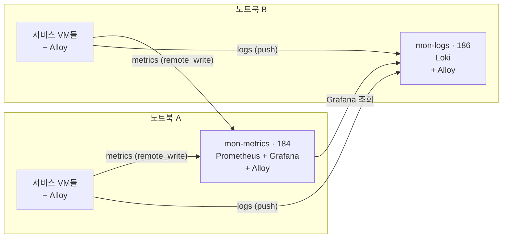

# ADR-002: 노트북 2대 환경의 모니터링(Grafana·Prometheus·Loki·Alloy) 구성

| 항목 | 내용 |
|---|---|
| 상태 | 제안됨 |
| 작성일 | 2026-11-06 |
| 적용 범위 | 노트북 2대에 배치된 FastAPI·nginx·HAProxy 서비스 VM과 모니터링 VM |
| 결정 대상 | 모니터링 VM 배치, 수집 방식, 리소스 상한, 보관 정책 |
| 관련 문서 | [ADR-001 서버 배치](serverSpec.md), [네트워크 정보](networkInfo.md), [프런트↔백엔드 연결 가이드](FrontToBackSetting.md) |
| 설정 파일 | 저장소 [`monitoring/`](../monitoring) |

## 1. 배경

노트북 2대에서 아래 서비스 VM이 이미 운영 중이다. OS는 모두 Ubuntu 24.04이고, 서비스는 apt와 systemd로 설치했다.

| 서비스 | VM |
|---|---|
| FastAPI (uvicorn, `tikit-api.service`) | 192.168.0.175, 176 |
| nginx (정적 파일 + `/api/` 프록시) | 192.168.0.177, 178 |
| HAProxy (179: 백엔드, 181: 프런트) | 192.168.0.179, 181 |

여기에 Grafana, Prometheus, Loki, Alloy를 추가한다. **모니터링을 추가해도 서비스 성능에 영향이 없어야 한다**는 것이 핵심 요구사항이다.

### 전제

- ADR-001은 모니터링을 PC 3(Mac)에 두도록 정했다. 이 문서는 **PC 3 없이 노트북 2대만 쓰는 경우**의 결정이다. PC 3을 쓸 수 있게 되면 7장의 재검토 조건에 따라 모니터링 VM을 그쪽으로 옮긴다.
- 노트북 사양(RAM, CPU)이 확정되지 않았다. 아래 할당값은 초기 예산이며 운영하면서 조정한다.
- 대상 규모는 서비스 VM 6대, 메트릭 시계열 수천 개, 로그 수 GB/일 이하로 가정한다.

## 2. 결정

**모니터링 VM 2개를 노트북마다 하나씩 둔다. 노트북 A에는 Prometheus와 Grafana, 노트북 B에는 Loki를 배치한다. 수집 에이전트는 모든 VM에 Alloy 하나만 설치한다.**



### VM 구성

| VM | IP | 노트북 | 서비스 | vCPU | RAM | 디스크 |
|---|---|---|---|---:|---:|---:|
| mon-metrics | 192.168.0.184 | A | Prometheus, Grafana, Alloy | 2 | 4GB | OS 20GB + 데이터 20GB |
| mon-logs | 192.168.0.186 | B | Loki, Alloy | 2 | 4GB | OS 20GB + 데이터 40GB |
| 기존 서비스 VM 6대 | 175~179, 181 | A/B | 기존 서비스 + Alloy | 변경 없음 | 변경 없음 | 변경 없음 |

- `networkInfo.md`에서 Grafana용으로 잡았던 192.168.0.183은 쓰지 않는다. Grafana를 184 VM에 합치므로 예비 IP로 돌려놓는다.
- 데이터 디스크는 VM에 별도 가상 디스크로 추가한다. 184는 `/var/lib/prometheus`, 186은 `/var/lib/loki`에 마운트한다.

### 프로세스별 메모리 예산과 상한

| VM | 프로세스 | 예상 사용량 | systemd 상한 (`MemoryMax`) |
|---|---|---:|---:|
| mon-metrics | Prometheus | 0.5~1GB | 1.6GB |
| mon-metrics | Grafana | 0.2~0.5GB | 0.8GB |
| mon-logs | Loki | 1~2GB | 3GB |
| 모든 VM | Alloy | 0.1~0.2GB | 0.3GB (CPU 50%) |

나머지 메모리는 OS와 파일 캐시에 쓰인다. Prometheus와 Loki는 파일 캐시가 있어야 조회가 빠르다.

## 3. 결정 근거

| 결정 | 근거 |
|---|---|
| Prometheus와 Loki를 서로 다른 노트북에 배치 | 메모리와 디스크 I/O를 가장 많이 쓰는 두 프로세스다. 한 노트북에 몰면 그 노트북의 서비스 VM만 느려진다. |
| Grafana를 Prometheus VM에 합침 | Grafana는 가볍다. 별도 VM을 만들면 게스트 OS에 약 1GB가 더 든다. |
| Alloy 하나로 메트릭과 로그를 모두 수집 | node_exporter와 promtail을 따로 둘 필요가 없어 VM당 프로세스가 하나 줄어든다. 설정 형식도 하나로 통일된다. |
| Alloy가 push(remote_write)하고 Prometheus는 저장만 | 대상이 늘어도 Prometheus 설정을 바꾸지 않는다. Alloy의 WAL 덕분에 Prometheus가 잠시 중단돼도 데이터를 재전송한다. |
| 출발지(Alloy)에서 불필요한 로그 제거 | 헬스체크 로그(179→FastAPI 3초 간격, 181→nginx)와 정적 파일 로그가 전체 로그의 대부분이다. 전송량, Loki 저장량, 조회 비용이 함께 줄어든다. |
| systemd로 메모리·CPU 상한 설정 | 같은 노트북 안에서 모니터링이 서비스 자원을 빼앗는 것을 원천적으로 막는다. |
| 바이너리 + systemd (Docker 미사용) | 기존 서비스 설치 방식(apt, systemd)과 같다. 컨테이너 런타임의 추가 오버헤드도 없다. |

## 4. 수집 구성

### 수집 대상

| VM | 메트릭 | 로그 | Alloy 설정 파일 |
|---|---|---|---|
| 전체 | 호스트(`prometheus.exporter.unix`), Alloy 자체 | journald 오류(priority ≤ 3) | `common.alloy` |
| FastAPI 175·176 | `/metrics` (prometheus-fastapi-instrumentator) | journald `tikit-api.service` | `fastapi.alloy` |
| nginx 177·178 | nginx-prometheus-exporter (`:9113`) | `/var/log/nginx/access.json.log`, `error.log` | `nginx.alloy` |
| HAProxy 179·181 | 내장 Prometheus exporter (`127.0.0.1:8405`) | `/var/log/haproxy.log` | `haproxy.alloy` |
| mon-metrics 184 | Grafana | Prometheus·Grafana journald | `mon-metrics.alloy` |
| mon-logs 186 | Loki | Loki journald | `mon-logs.alloy` |

Alloy는 `/etc/alloy` 디렉터리 안의 `*.alloy` 파일을 모두 읽는다. 그래서 모든 VM에 `common.alloy`를 두고, 역할별 파일 하나를 추가하는 방식으로 배포한다.

### 라벨 규칙 (Loki)

| 라벨 | 값 예시 | 비고 |
|---|---|---|
| `host` | `nginx177` | `ALLOY_HOST` 환경 변수. 177·178·181 호스트명이 모두 `test`라서 hostname은 쓰지 않는다. |
| `service` | `fastapi`, `nginx`, `haproxy`, `system`, `monitoring` | |
| `log_type` | `access`, `error` | nginx에만 붙는다. |
| `level` | `INFO`, `ERROR` | FastAPI에만 붙는다. |

**request_id, user_id, IP, URI는 라벨로 만들지 않는다.** 이런 값은 로그 본문에 두고, 조회할 때 `| json | uri="/api/v1/..."` 형태로 필터링한다. 값 종류가 많은 라벨은 Loki 스트림 수를 폭증시켜 메모리와 성능을 크게 떨어뜨린다.

## 5. 보관 정책과 성능 설정

| 항목 | Prometheus | Loki |
|---|---|---|
| 수집·전송 주기 | 30초 (Alloy·Grafana 등 자체 메트릭은 60초) | 2초 배치 |
| 보관 기간 | 7일 | 3일 (`retention_period: 72h`) |
| 용량 상한 | `retention.size=15GB` | 보관 기간 + compactor 삭제 |
| 조회 제한 | `query.max-concurrency=4` | `max_query_parallelism: 4`, `max_query_series: 500` |
| 수집 제한 | - | `ingestion_rate_mb: 4`, `max_global_streams_per_user: 1000` |

- Loki는 `compactor.retention_enabled: true`일 때만 실제로 디스크를 비운다. `retention_period`만 설정하면 용량 상한이 보장되지 않는다.
- 대시보드에서 반복 계산하는 쿼리(CPU 사용률, 요청 수, p95/p99 응답 시간)는 recording rule(`monitoring/prometheus/rules/recording.yml`)로 미리 계산해 둔다.
- Grafana 대시보드 자동 새로고침의 최소값은 30초로 강제한다(`GF_DASHBOARDS_MIN_REFRESH_INTERVAL`).

## 6. 설치 절차

모든 명령은 대상 VM에서 실행한다. 설정 파일은 저장소의 `monitoring/` 디렉터리에서 VM으로 복사한다.

### 6-0. Grafana apt 저장소 등록 (184, 186, 서비스 VM 전부)

Alloy, Loki, Grafana는 Grafana 공식 apt 저장소에서 설치한다.

```bash
sudo apt install -y gpg
sudo mkdir -p /etc/apt/keyrings
wget -q -O - https://apt.grafana.com/gpg.key | gpg --dearmor | sudo tee /etc/apt/keyrings/grafana.gpg > /dev/null
echo "deb [signed-by=/etc/apt/keyrings/grafana.gpg] https://apt.grafana.com stable main" | sudo tee /etc/apt/sources.list.d/grafana.list
sudo apt update
```

### 6-1. FastAPI 앱 준비 (코드 변경 필요)

`/metrics` 엔드포인트를 추가한다. 이 ADR에는 앱 코드 변경이 포함되지 않으므로 별도 작업으로 진행한다.

```bash
# backend/requirements.txt 에 추가
prometheus-fastapi-instrumentator>=7.0
```

```python
# backend/app/main.py
from prometheus_fastapi_instrumentator import Instrumentator

Instrumentator(
    excluded_handlers=["/health", "/metrics"],   # 헬스체크는 집계에서 제외
).instrument(app).expose(app, include_in_schema=False)
```

**uvicorn을 `--workers 2`로 실행하므로 multiprocess 모드가 반드시 필요하다.** 설정하지 않으면 scrape할 때마다 두 worker 중 하나의 값만 무작위로 응답한다. `tikit-api.service`에 아래 내용을 추가한다.

```ini
[Service]
Environment=PROMETHEUS_MULTIPROC_DIR=/run/tikit-api/metrics
RuntimeDirectory=tikit-api
ExecStartPre=/bin/sh -c 'rm -rf /run/tikit-api/metrics && mkdir -p /run/tikit-api/metrics'
```

- 핸들러 라벨은 `/api/v1/performances/{performance_id}` 같은 라우트 템플릿으로 기록된다. 실제 ID는 라벨이 되지 않는다.
- 179 HAProxy에서 `/metrics`를 외부로 노출하지 않도록 차단한다(`monitoring/haproxy/prometheus-exporter.cfg` 참고).

### 6-2. mon-metrics (184): Prometheus + Grafana

```bash
sudo apt install -y --no-install-recommends prometheus   # node-exporter 가 딸려오지 않게 --no-install-recommends
sudo apt install -y grafana

sudo cp prometheus/prometheus.yml /etc/prometheus/prometheus.yml
sudo mkdir -p /etc/prometheus/rules
sudo cp prometheus/rules/recording.yml /etc/prometheus/rules/
sudo cp prometheus/prometheus.default /etc/default/prometheus
promtool check config /etc/prometheus/prometheus.yml

sudo cp grafana/provisioning/datasources/datasources.yml /etc/grafana/provisioning/datasources/
cat grafana/grafana-server.env | sudo tee -a /etc/default/grafana-server

sudo systemctl enable --now prometheus grafana-server
```

Grafana(`http://192.168.0.184:3000`)에 처음 로그인하면 관리자 비밀번호를 바로 변경한다. 비밀번호는 이 문서에 적지 않는다.

### 6-3. mon-logs (186): Loki

```bash
sudo apt install -y loki
sudo cp loki/config.yml /etc/loki/config.yml
sudo mkdir -p /var/lib/loki && sudo chown -R loki /var/lib/loki   # 데이터 디스크 마운트 후 실행
sudo systemctl enable --now loki
curl -s http://localhost:3100/ready   # "ready"
```

### 6-4. 서비스별 사전 작업

| VM | 작업 | 파일 |
|---|---|---|
| nginx 177·178 | JSON 접근 로그 + `stub_status` 설정, `sudo apt install -y prometheus-nginx-exporter` | `monitoring/nginx/monitoring.conf` → `/etc/nginx/conf.d/` |
| HAProxy 179·181 | `haproxy -vv \| grep -i prometheus`로 exporter 포함 여부 확인 후 설정 추가 | `monitoring/haproxy/prometheus-exporter.cfg` |

nginx exporter가 읽을 주소와 수신 주소를 `/etc/default/prometheus-nginx-exporter`에 명시한다. exporter 버전에 따라 옵션 앞의 대시 개수가 다르므로(`-nginx.scrape-uri` 또는 `--nginx.scrape-uri`) `prometheus-nginx-exporter --help`로 먼저 확인한다.

```bash
ARGS="--nginx.scrape-uri=http://127.0.0.1:8080/stub_status --web.listen-address=127.0.0.1:9113"
```

적용 후에는 각각 문법을 검사하고 reload한다.

```bash
sudo nginx -t && sudo systemctl reload nginx
sudo haproxy -c -f /etc/haproxy/haproxy.cfg && sudo systemctl reload haproxy
```

### 6-5. Alloy (모든 VM)

```bash
sudo apt install -y alloy

sudo cp alloy/common.alloy /etc/alloy/
sudo cp alloy/<역할>.alloy /etc/alloy/          # fastapi / nginx / haproxy / mon-metrics / mon-logs
sudo rm -f /etc/alloy/config.alloy              # 패키지 기본 예제 제거

sudo cp alloy/alloy.default /etc/default/alloy
sudo sed -i 's/ALLOY_HOST="CHANGE_ME"/ALLOY_HOST="nginx177"/' /etc/default/alloy   # VM마다 변경

# 로그 읽기 권한
sudo usermod -aG adm,systemd-journal alloy

# 리소스 상한
sudo mkdir -p /etc/systemd/system/alloy.service.d
sudo cp systemd/alloy-limits.conf /etc/systemd/system/alloy.service.d/limits.conf

sudo systemctl daemon-reload
sudo systemctl enable --now alloy
sudo systemctl status alloy
```

설정 오류는 `journalctl -u alloy -n 50`으로 확인한다. Alloy UI(`http://127.0.0.1:12345`)는 VM 내부에서 `curl`이나 SSH 터널로만 접근한다.

### 6-6. 리소스 상한 (184, 186)

`monitoring/systemd/README.md`를 참고해 Prometheus, Grafana, Loki에 drop-in을 적용한다.

### 6-7. 방화벽 (184, 186)

현재 모든 서버에서 `ufw`가 비활성이다. Prometheus와 Loki에는 인증이 없으므로 모니터링 VM 2대는 내부 대역에서만 접근하도록 제한한다. `192.168.0.160/27`은 .160~.191 범위다.

```bash
sudo ufw allow OpenSSH                      # 반드시 먼저 허용 (SSH 끊김 방지)
# 184
sudo ufw allow from 192.168.0.160/27 to any port 9090 proto tcp   # Prometheus (remote_write 수신)
sudo ufw allow 3000/tcp                                           # Grafana
# 186
sudo ufw allow from 192.168.0.160/27 to any port 3100 proto tcp   # Loki
sudo ufw enable
```

### 6-8. 동작 확인

| 확인 항목 | 방법 | 기대 결과 |
|---|---|---|
| 메트릭 유입 | Grafana Explore → Prometheus: `count by (host) (up)` | host 8개 |
| 로그 유입 | Grafana Explore → Loki: `sum by (host) (count_over_time({service=~".+"}[5m]))` | host 8개 |
| FastAPI 메트릭 | `fastapi:http_requests:rate5m` | 175·176 값 존재 |
| 헬스체크 로그 제거 | `{service="fastapi"} \|= "/health"` | 결과 없음 |
| Alloy 오버헤드 | `rate(process_cpu_seconds_total{job="alloy"}[5m])` | VM당 0.05코어 이하 |
| Loki 디스크 | `host:node_filesystem_utilisation:ratio{host="mon-logs186"}` | 3일 이후 증가세가 평탄해짐 |

## 7. 결과 및 제약

### 기대 효과

- 모니터링 부하가 두 노트북에 나뉘고, systemd 상한으로 서비스 VM 영향이 제한된다.
- 서비스 VM마다 에이전트가 하나(Alloy)뿐이라 설치와 운영이 단순하다.
- 헬스체크와 정적 파일 로그를 출발지에서 버려 네트워크, 디스크, 조회 비용이 모두 줄어든다.

### 수용하는 제약

- 노트북 A가 중단되면 메트릭과 대시보드를, 노트북 B가 중단되면 로그를 볼 수 없다.
- 모니터링이 서비스와 같은 물리 장비에 있어서, 노트북이 과부하일 때 모니터링도 함께 느려진다. 부하 테스트 결과를 해석할 때는 184·186 VM의 자원 사용률을 함께 확인한다.
- Alloy WAL은 짧은 중단만 보완한다. 장시간 중단된 구간의 메트릭은 유실될 수 있다.
- 알림(Alertmanager 또는 Grafana Alerting)은 이 ADR에 포함하지 않는다.
- DB(171~174)와 HAProxy 180은 이 ADR에 포함하지 않는다. 추가할 때는 같은 방식으로 `common.alloy`를 배포하고, `prometheus.exporter.mysql`과 `prometheus.exporter.mongodb`를 담은 역할 파일을 추가한다.

### 운영 체크리스트

- 노트북은 전원을 항상 연결하고, 절전과 덮개 닫힘 시 잠자기를 해제한다.
- 두 노트북은 Wi-Fi가 아닌 유선 LAN으로 연결한다.
- VM 디스크 파일은 노트북의 SSD에 둔다.
- 177·178·181의 호스트명을 역할에 맞게 변경하는 것을 권장한다(현재 모두 `test`).

## 8. 재검토 조건

- PC 3(Mac) 또는 별도 장비를 모니터링 전용으로 쓸 수 있게 된 경우: 모니터링 VM을 그쪽으로 이전한다.
- 모니터링 VM의 메모리가 상한(`MemoryHigh`)에 자주 도달하는 경우
- Loki 디스크가 3일 보관 기준으로도 데이터 디스크의 70%를 넘는 경우
- Prometheus 시계열 수(`prometheus_tsdb_head_series`)가 10만 개를 넘는 경우
- 서비스 VM이 추가되거나 DB 모니터링이 필요한 경우

## 9. 참고 자료

- [Grafana Alloy 설정 문법과 컴포넌트](https://grafana.com/docs/alloy/latest/reference/components/)
- [Alloy `prometheus.exporter.unix`](https://grafana.com/docs/alloy/latest/reference/components/prometheus/prometheus.exporter.unix/)
- [Alloy `loki.process` 스테이지](https://grafana.com/docs/alloy/latest/reference/components/loki/loki.process/)
- [Loki 로그 보관 정책](https://grafana.com/docs/loki/latest/operations/storage/retention/)
- [Loki 라벨 모범 사례](https://grafana.com/docs/loki/latest/get-started/labels/bp-labels/)
- [Prometheus 저장소 및 remote write receiver](https://prometheus.io/docs/prometheus/latest/storage/)
- [prometheus-fastapi-instrumentator](https://github.com/trallnag/prometheus-fastapi-instrumentator)
- [HAProxy Prometheus exporter](https://www.haproxy.com/documentation/haproxy-configuration-tutorials/alerts-and-monitoring/prometheus/)
